# Figures

Generated figures, one directory per script (PDF + PNG, SVG where used for
assembly). See the top-level README for the script behind each panel.

**Fig — SOM atlas.** The 756-neuron expressed-gene map: functional
territories and supported programmes (a), the programme × virus summary of
the supported induced programmes (b), and the three temporal phases,
measured (c).

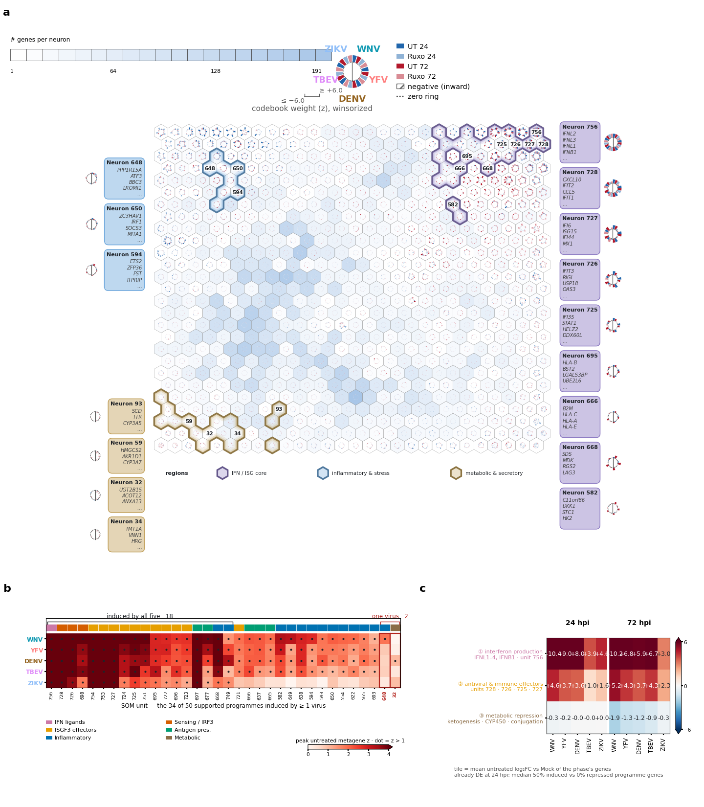

**Fig — untreated conservation UpSet.** Genes induced (bars up) and
repressed (bars down) by exactly each virus combination, untreated arm only.

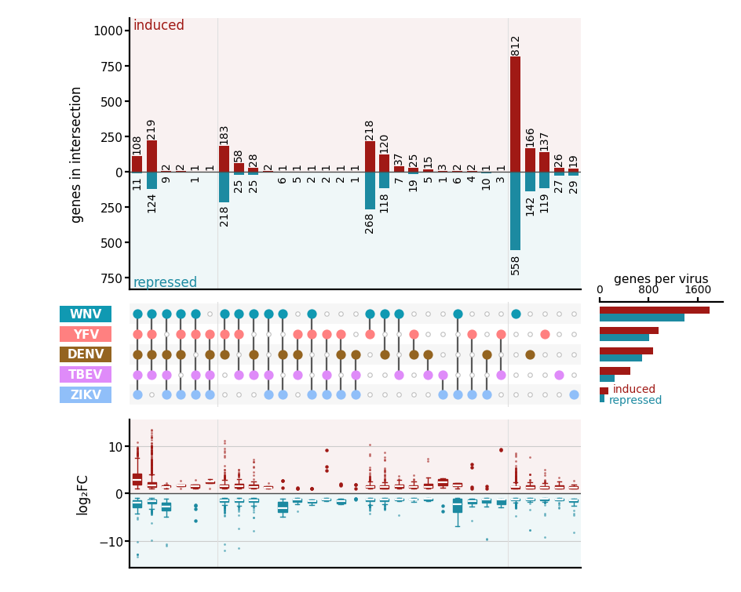

**Fig — temporal phases.** Per-phase unit trajectories and the
gene-level heat map behind the early/late/sustained succession.

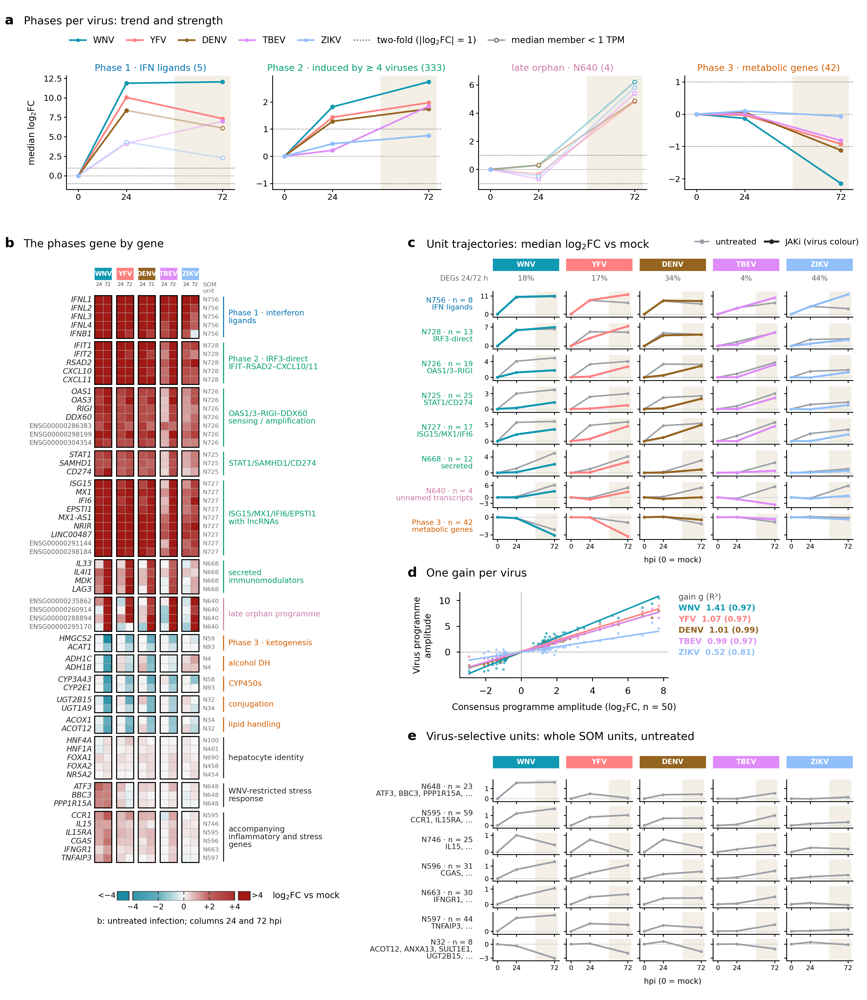

**Fig — UT vs JAKi.** Volcano of the untreated-vs-ruxolitinib
contrast at 72 hpi with the 382 Schoggins ISGs highlighted (representative
panel; the directory holds the waterfalls and top-50 heat maps too).

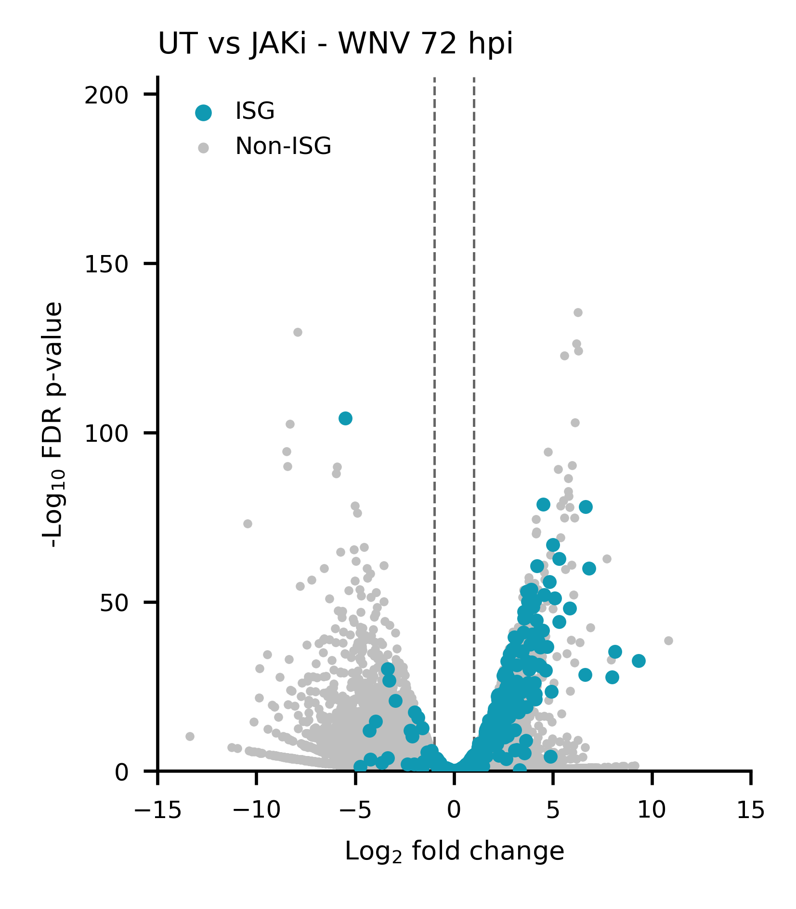

**Fig — ISG SOM codes map.** The 25-neuron 382-ISG map; each neuron's
fan glyph encodes its 20 condition codebook weights.

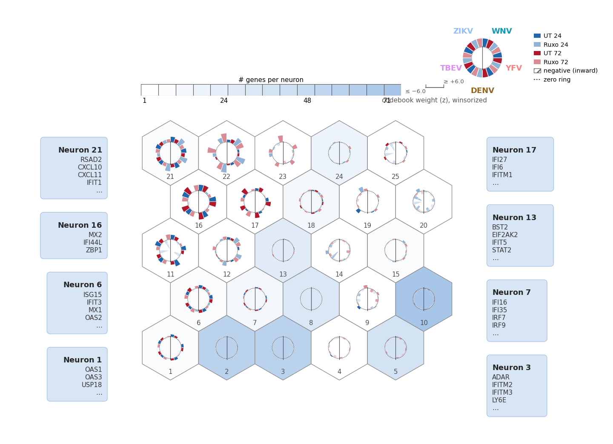

**Fig — response terrain.** Codebook-weight surface per condition,
five viruses × untreated/JAKi × 24/72 hpi.

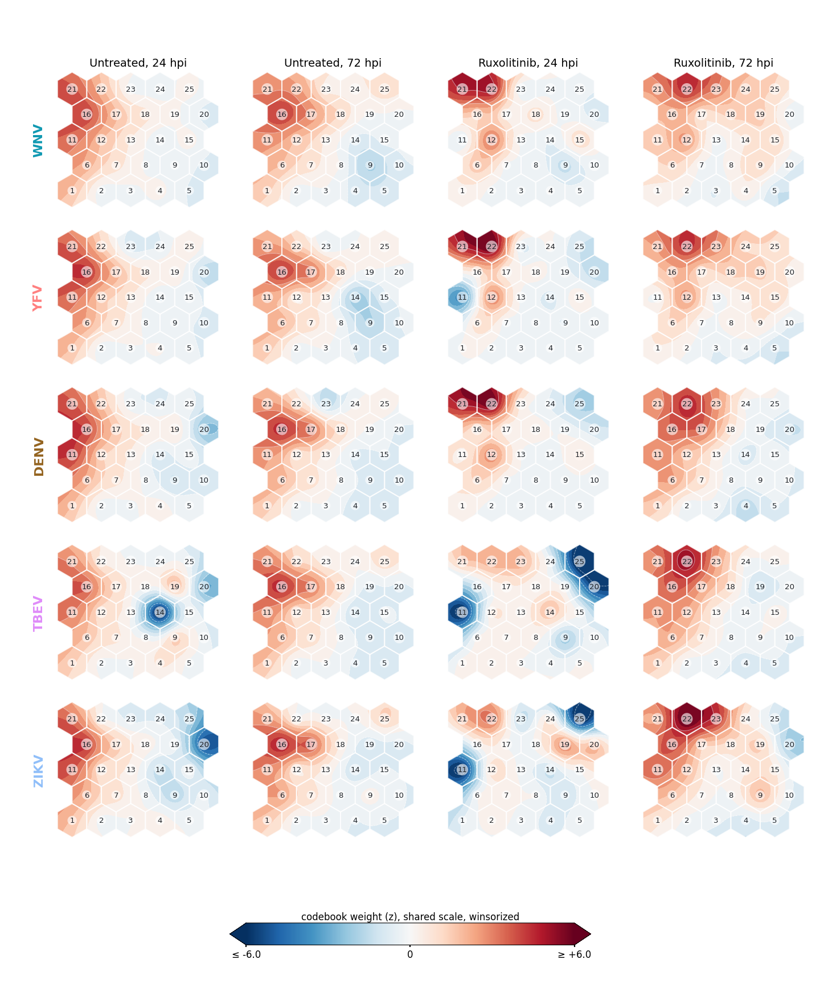

**Fig — JAK-STAT dependence terrain.** Mean dependence index J per
neuron, one panel per virus.

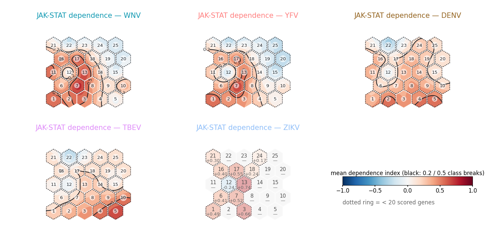

**Fig — JAK-tier chord.** Programmes on the rim, ribboned to their
dependence tier per virus.

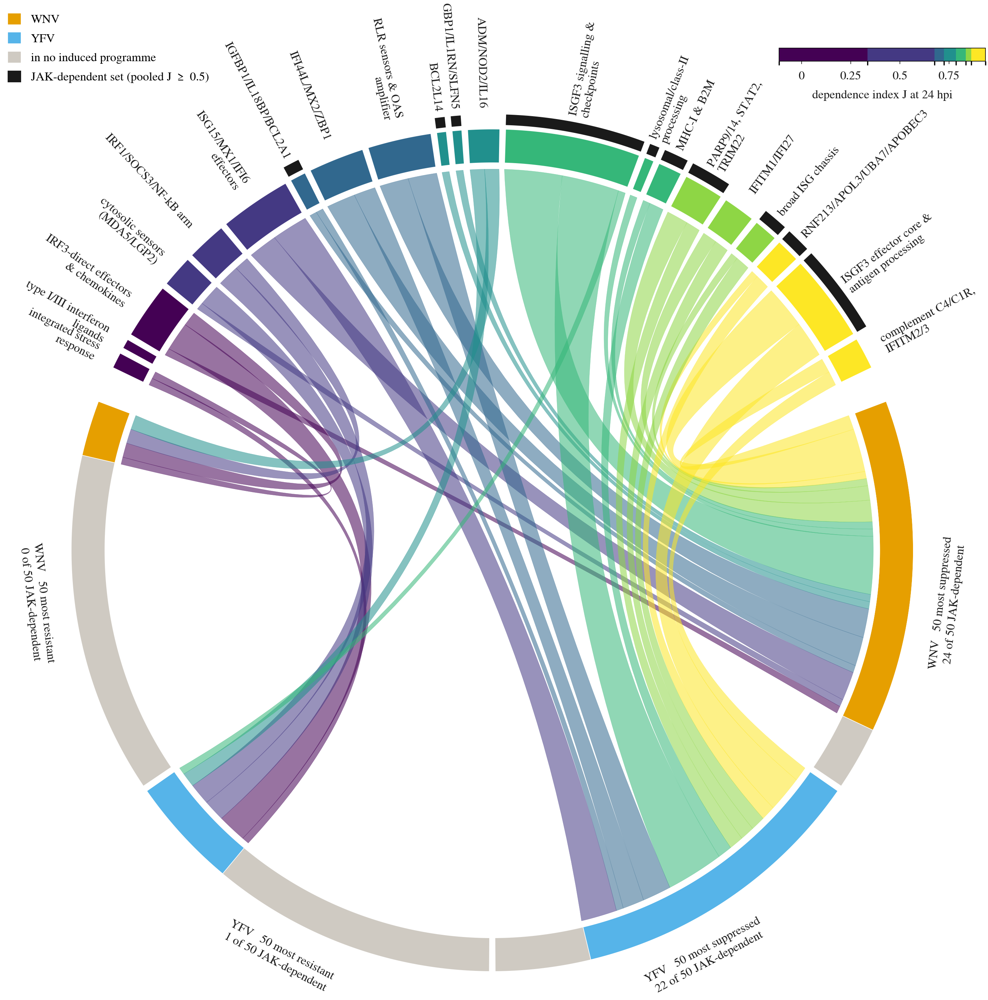

**Fig — conservation under JAKi.** The virus-restricted units and
the repression shared across viruses, untreated vs ruxolitinib.

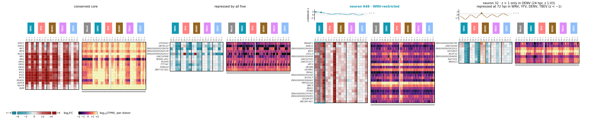

**Fig — late inflammation.** AP-1 and chemokine programmes: unit
kinetics above the gene heat map.

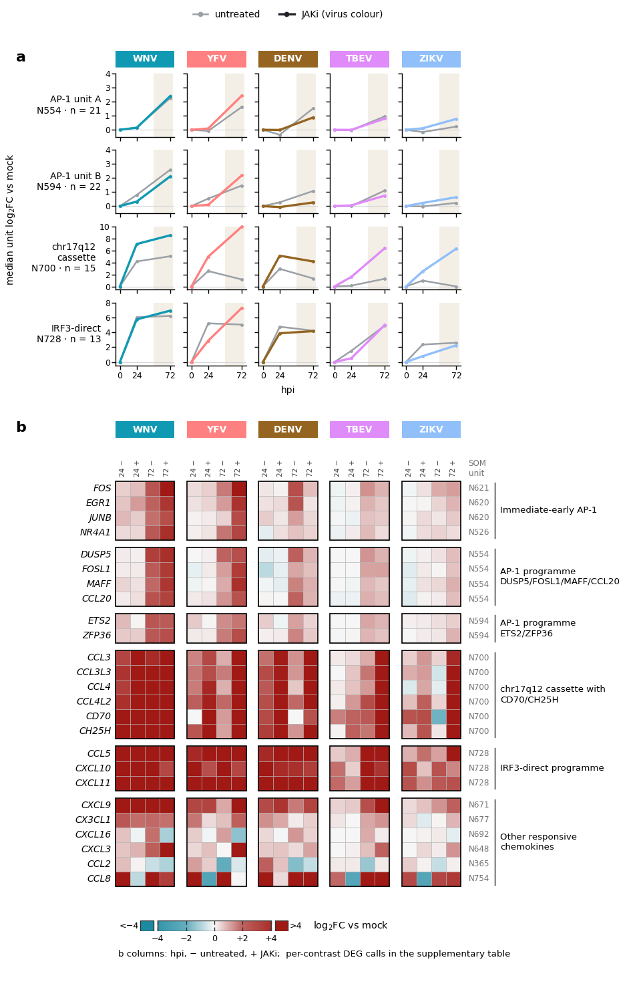

**Fig — late vulnerabilities.** Ferroptosis, oxysterol and
ER-module programmes, same grammar.

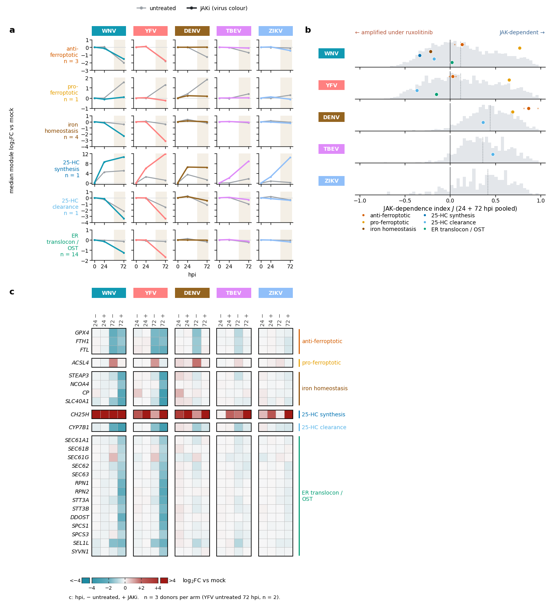

**Fig — JAK-STAT dependence, combined supplement.** J vs amplitude for
the supported programmes, the 53-gene ISG core and its 24 → 72 hpi decline.

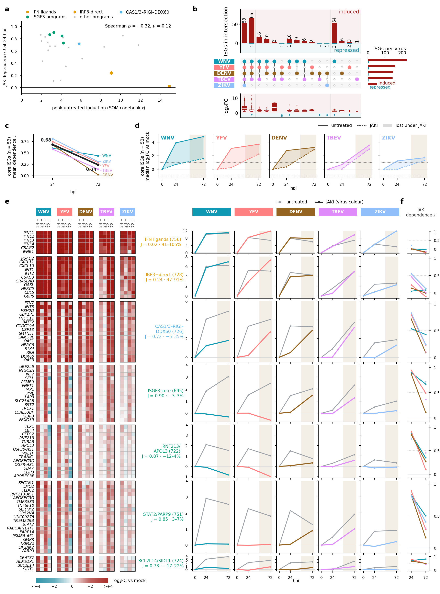
